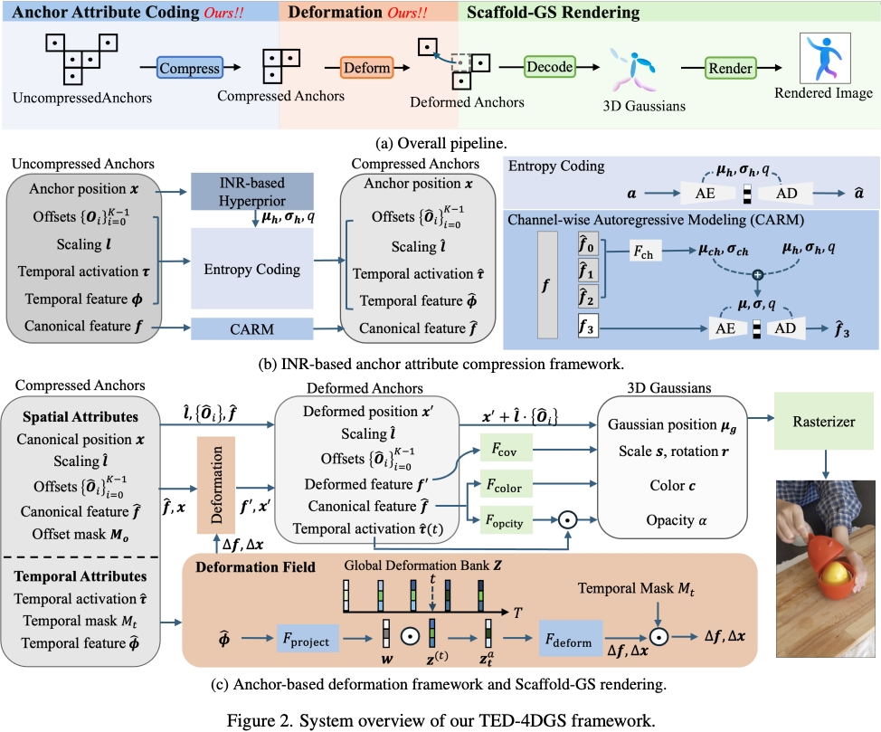
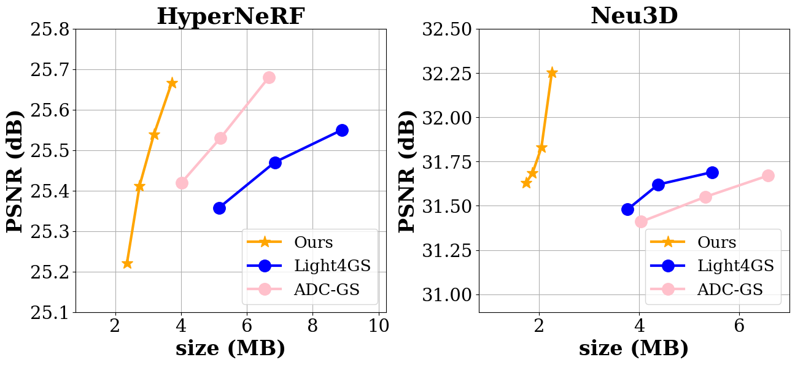

# WACV 2026 : TED-4DGS: Temporally Activated and Embedding-based Deformation for 4DGS Compression

Accpeted to WACV 2026

[Cheng-Yuan Ho*](https://www.linkedin.com/in/kelvincyho?utm_source=share&utm_campaign=share_via&utm_content=profile&utm_medium=ios_app), 
[He-Bi Yang](https://www.linkedin.com/in/hebiyang?utm_source=share&utm_campaign=share_via&utm_content=profile&utm_medium=android_app ), 
[Jui Chiu Chiang](https://chiang.ccu.edu.tw/p/404-1255-68777.php?Lang=zh-tw), 
[Yu-Lun Liu](https://yulunalexliu.github.io/), 
[Wen-Hsiao Peng](https://sites.google.com/g2.nctu.edu.tw/wpeng)

[[`Arxiv`](https://www.arxiv.org/abs/2512.05446)] [[`Project Page`](https://nycu-mapl.github.io/TED-4DGS_page/)] 


## Abstract
<p align="left">

</p>

We present TED-4DGS, a novel framework that unifies Temporally Activated mechanisms with Embedding-based Deformation for high-efficiency 4DGS compression. 
Our approach introduces learnable temporal activation parameters for each anchor to explicitly model appearance and disappearance, 
effectively handling occlusion and disocclusion. Furthermore, we incorporate an INR-based hyperprior and a channel-wise autoregressive model to achieve compact attribute compression. 
Experimental results demonstrate that TED-4DGS achieves state-of-the-art rate-distortion performance on real-world datasets, 
significantly reducing file sizes while maintaining superior rendering quality compared to existing methods.

## Performance
<p align="left">

</p>


## 🔧 Code Availability
We are currently preparing and cleaning up the implementation.  
The code and instructions will be released here soon. Please stay tuned! ⭐


## 📢 Citation
If you find our work helpful, please cite:

## Contact

- Cheng-Yuan Ho: kelvinhe0218.cs12@nycu.edu.tw

## Citation

If you find our work helpful, please consider citing:

```bibtex
@misc{ho2025ted4dgstemporallyactivatedembeddingbased,
      title={TED-4DGS: Temporally Activated and Embedding-based Deformation for 4DGS Compression}, 
      author={Cheng-Yuan Ho and He-Bi Yang and Jui-Chiu Chiang and Yu-Lun Liu and Wen-Hsiao Peng},
      year={2025},
      eprint={2512.05446},
      archivePrefix={arXiv},
      primaryClass={cs.CV},
      url={https://arxiv.org/abs/2512.05446}, 
}
```

## LICENSE

Please follow the LICENSE of [3D-GS](https://github.com/graphdeco-inria/gaussian-splatting).

## Acknowledgement

 - We thank all authors from [3D-GS](https://github.com/graphdeco-inria/gaussian-splatting) for presenting such an excellent work.
 - We thank all authors from [Scaffold-GS](https://github.com/city-super/Scaffold-GS) for presenting such an excellent work.
  - We thank all authors from [HAC](https://github.com/YihangChen-ee/HAC) for presenting such an excellent work.
